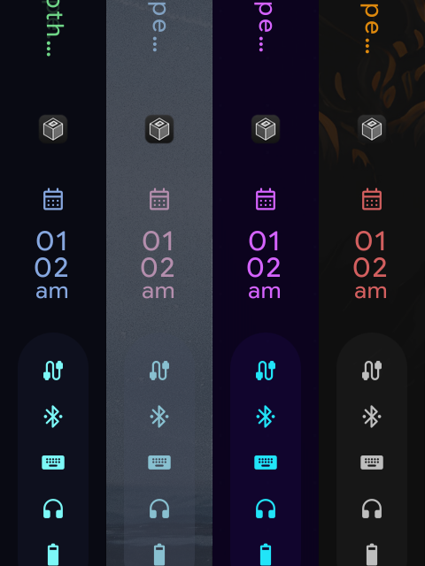
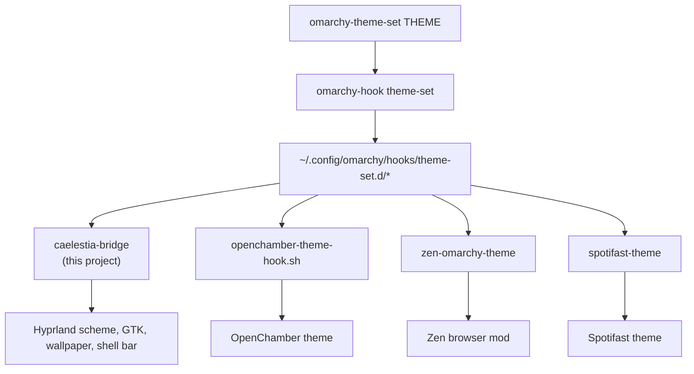

# caelestia-omarchy-themes

Make **Omarchy the single source of theme truth for the [Caelestia](https://github.com/caelestia-dots/shell) shell**.

Caelestia and Omarchy are both desktop shells that want to own your palette, and
they do not talk to each other. Out of the box, switching an Omarchy theme leaves
Caelestia's bar, Hyprland's window borders, the wallpaper, and GTK apps on
whatever Caelestia booted with. This makes an Omarchy theme change win everywhere
Caelestia is visible, and drops a working theme picker into Caelestia's own Nexus
panel so you can switch from the shell instead of the terminal.

On a stock install, Caelestia's Colours page (*Nexus → Wallpaper & style → Colours*)
is a "Page under construction" stub. This replaces it with a grid of the Omarchy
themes installed on your machine, each with its preview and accent.

## Screenshots

The Caelestia bar under four Omarchy themes, left to right: **Hackerman**,
**Nord**, **Synthwave**, **Matte Black**. One bar, one session, four theme
switches — this is what the bridge is for.



To reproduce these against your own themes, see `tools/capture-theme.sh`.

## What one theme switch touches

| | |
|---|---|
| `~/.local/state/caelestia/scheme.json` | the palette `caelestia-shell` watches — the bar and panel |
| `hypr/scheme/current.lua` | window borders, shadows, the empty-desktop background |
| `~/.config/caelestia/hypr-vars.lua` | border gradients, for Hyprland ≥ 0.56 |
| `~/.config/gtk-3.0/`, `gtk-4.0/` (`gtk.css`, `thunar.css`) | GTK apps, including Thunar's text |
| `~/.local/state/caelestia/wallpaper/path.txt` | the wallpaper, which the shell switches live |

## Requirements

- Arch-based system with `pacman`
- [Omarchy](https://omarchy.org), for `omarchy-theme-set` and its themes
- `caelestia-shell` installed (`/etc/xdg/quickshell/caelestia` present)

## Install

```sh
git clone https://github.com/thenobody0817/caelestia-omarchy-themes
cd caelestia-omarchy-themes
./install.sh
```

Then open **Nexus → Wallpaper & style → Colours**.

The installer needs `sudo` once, to drop a pacman hook in
`/etc/pacman.d/hooks/`. Run it as your normal user, not root.

## Uninstall

```sh
./uninstall.sh
```

Restores the stock stub, removes both hooks and all three helpers. The state
files the bridge wrote are deliberately left in place — they are state, not
configuration this project owns, and deleting them would leave you on an
undefined palette. They simply stop being updated, and Caelestia's own CLI takes
over again.

## How it works

There are two independent halves, and **both are needed**. This is the part worth
understanding before installing, because it explains most of the questions below.

**The bridge** is what makes a theme change take effect. Picking a theme runs
`omarchy-theme-set`, and stock Omarchy knows nothing about Caelestia — all it does
is fan out to `~/.config/omarchy/hooks/theme-set.d/`. This project's hook
(`caelestia-bridge`) is registered there and pushes the new palette into every
file Caelestia reads. It is installed to `~/.local/bin/caelestia-theme-bridge`, and
you can run it by hand:

```sh
caelestia-theme-bridge --dry-run   # print the mapping, write nothing
caelestia-theme-bridge --no-gtk --no-wallpaper
```

**The page** is the picker itself, dropped into Caelestia's shell tree.

Caelestia loads its shell from the first of `~/.config/quickshell/caelestia` or
`/etc/xdg/quickshell/caelestia` that exists, and does **not** merge them. So the
page needs a full overlay tree, and a `caelestia-shell` upgrade — which replaces
the packaged tree — has to be caught and re-applied. That is what the pacman hook
is for.

| Path | What |
|---|---|
| `~/.local/share/caelestia-shell-overlay/` | the overlay: the one QML page it replaces |
| `~/.local/bin/caelestia-theme-bridge` | the bridge that translates the palette |
| `~/.local/bin/omarchy-caelestia-themes` | lists Omarchy themes as JSON for the page |
| `~/.local/bin/sync-caelestia-shell` | rebuilds the shell fork from package + overlay |
| `~/.config/omarchy/hooks/theme-set.d/caelestia-bridge` | runs the bridge on every theme switch |
| `/etc/pacman.d/hooks/95-caelestia-shell-omarchy.hook` | re-applies the page after each `caelestia-shell` upgrade |

`~/.config/quickshell/caelestia` is a **generated tree**, not a config
directory: package contents plus the overlay, rebuilt on demand. That is why
`sync-caelestia-shell` uses `rsync --delete`, and why hand-edits to it do not
survive the next upgrade.

Because that sync is normally driven by a *root* pacman hook, anything about to
be lost is copied out first rather than silently deleted:

```text
note: 50 local file(s) under ~/.config/quickshell/caelestia differ from the package and
      are being replaced. Your copies are kept in:
        ~/.local/state/caelestia-shell-backup/20261010T220118
          shell.qml
          ...
```

If you have been editing the shell tree directly, revert those edits from the
backup after each upgrade, or keep them in a dotfiles repo and re-apply.

## Where this fits

Omarchy is the single source of theme truth. This project is only one of its
consumers. `omarchy-theme-set` runs everything in
`~/.config/omarchy/hooks/theme-set.d/`, and each hook there adapts one app to the
new palette — independently, and in parallel:



Nothing here is layered on anything else. Caelestia has no idea your browser is
also being themed, and your browser has no idea about Caelestia — they are
siblings, not steps. That is why one switch turns everything green at once, and
why removing one hook changes exactly one app's behaviour.

This repository is **only the Caelestia half**. It themes the shell, Hyprland's
borders and background, the wallpaper, and — through the GTK stylesheets — GTK
apps like Thunar. It does **not** theme your browser, your music player, or any
app that keeps its own palette rather than reading GTK or Hyprland's. If you want
another app to follow, you add it to the hooks directory above; you do not extend
this project. That directory is the extension point, and it is the whole idea.

## Two things to know

**GTK is co-owned.** Caelestia's own CLI writes `gtk.css` and `thunar.css` too,
painting them from *its* palette rather than Omarchy's. Without this project they
go stale on every theme switch — and because Omarchy's base theme is plain
Adwaita-dark, whose widgets read `@theme_*` names Caelestia's template never
defines, the result is Thunar's light-grey text on a themed background. The
bridge writes both name sets and pins the text colours to fix that.

That means two tools write the same two files. The bridge wins here because it
runs on every theme switch, but if you manage those stylesheets yourself, or use
a different GTK setup, pass `--no-gtk` to the hook or drop the bridge entirely.
`--no-wallpaper` exists for the same reason.

**Hyprland needs a reload.** The bridge does it via `hyprctl reload` from the
hook. If you apply a theme from a machine without a running session, the next
`hyprctl reload` picks it up.

## Testing

```sh
./test/smoke.sh
```

Checks the things that can be checked without a live Wayland session: that the
JSON the page reads is well-formed, that the bridge's `--dry-run` writes nothing
and reports a scheme for both light and dark themes, and that the sync's drift
detection backs up edited files while ignoring the overlay's own.

## Regenerating the screenshots

```sh
./tools/capture-theme.sh --bar --prefix bar hackerman nord synthwave matte-black
```

Switches each theme in turn, waits for the shell to pick it up, captures with
`grim`, and restores the theme you started from. `--list` prints what is
installed, `--full` captures the whole output instead of a crop, and
`--geometry G` takes any `x,y WxH` region.

It is safe to interrupt. The theme you started from is stamped to
`~/.local/state/` before the first switch, so a hard kill cannot leave your
desktop on whichever theme it happened to be killed on — the next run notices the
stamp and restores it first.

## Credits

The Colours page is a fork of `caelestia-shell`'s own `ColourSelect.qml`, which
is GPL-3.0-only; this repo is too (see [LICENSE](LICENSE)).
